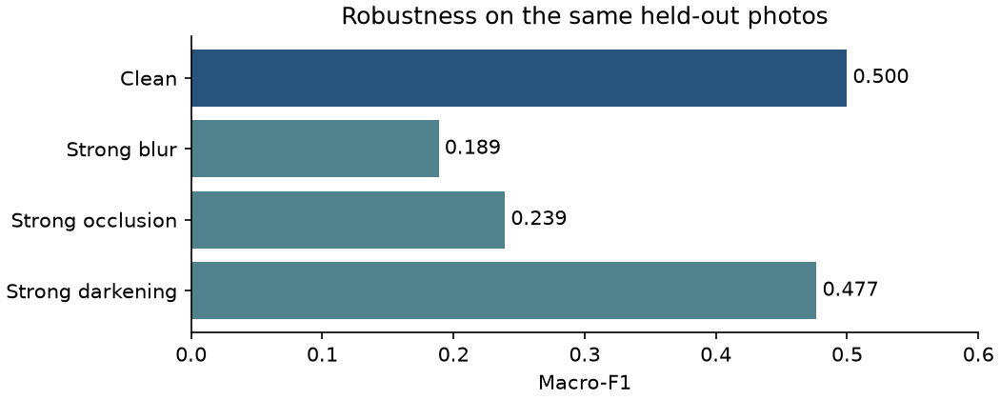
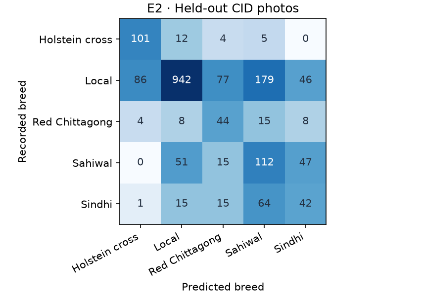

```{=latex}
\begin{titlepage}
\centering
\vspace*{2.2cm}
{\large\sffamily CS4045 · Deep Learning for Perception\par}
\vspace{1.8cm}
{\huge\sffamily\bfseries Cattle Breed Classification\\[4pt]from Images Using Transfer Learning\par}
\vspace{0.55cm}
{\Large\sffamily CattleClass · Final project report\par}
\vspace{1.8cm}
{\large\sffamily Group members\par}
\vspace{0.3cm}
\begin{tabular}{ll}
Muneeb Ul Haq & 23K-0578\\[6pt]
Shaikh Hassan Nafees & 23K-0769\\[6pt]
Shayan Ahmed & 23K-0551
\end{tabular}
\vspace{1.4cm}

\textbf{GitHub repository}\\[3pt]
\url{https://github.com/ShayanAhmed12/CattleClass}
\vfill
Fall 2026 · Submission deadline 29 November 2026
\end{titlepage}
```

## 1 Introduction

This project measures how well image models predict cattle breed and recorded traits on independently held-out animals from CID. Farmers, livestock traders and dairy record keepers may encounter cattle in unfamiliar settings. A photo classifier could supply a candidate breed for inspection. The intended use is decision support alongside an experienced handler or verified records. Breed identity can depend on ancestry, and the model observes only what is visible in a photograph.

The task is five-class image classification. Each input is one RGB photo and each model output is a probability over Holstein cross, Local, Red Chittagong, Sahiwal and Sindhi. The CID label Local groups indigenous cattle under a common dataset label. The study uses CID because it links breed, age and weight to the photographed animals. The breed evaluation tests controlled changes to lighting, sharpness and visibility.

**Final study scope.** The group decided to omit the independent on-farm evaluation (proposal E3). The final report uses grouped held-out CID results for breed, robustness, age and weight. Generalization to independent farms remains unmeasured in the final study. The breed and research inference models are available from the [model release](https://github.com/ShayanAhmed12/CattleClass/releases/tag/cid-models-v1). The demo recording remains private.

### Related work and contribution

The CID publication and dataset provide images and metadata for Bangladeshi market cattle. EfficientNet-B0 supplies an ImageNet-pretrained representation for transfer learning. The evaluation holds out duplicate-linked animal groups and compares breed predictions under clean and corrupted conditions. The same groups support the trait benchmarks. [CID publication](https://doi.org/10.1145/3542954.3543018) · [EfficientNet](https://proceedings.mlr.press/v97/tan19a.html)

\newpage

## 2 Data sources and label mapping

The downloaded main CID archive contains 514 four-photo folders and 513 metadata records. The accompanying YouTube archive was excluded. The index removes spaces when matching SKUs, excludes the folder without a label and keeps the five classes with enough animals for grouped evaluation. Pabna, Brahma and Mir Kadim are excluded. Local makes up roughly 70% of the retained animals, so an accuracy figure alone can hide poor results on the other classes. The local CID sample grid displays all four indexed views of one example per class. All four photos enter the any-view protocol. Across 503 images per suffix, the pose audit found 475, 497 and 434 image-left profiles for suffixes 0, 1 and 2, and 496 image-right profiles for suffix 3. The labels describe direction within the frame. [Data provenance and checksums](data.md)

| CID class | Source animal IDs | Indexed photos |
|---|---:|---:|
| Holstein cross | 32 | 128 |
| Local | 353 | 1,412 |
| Red Chittagong | 21 | 84 |
| Sahiwal | 59 | 236 |
| Sindhi | 38 | 152 |
| **Total** | **503** | **2,012** |

CID records indicate 375 animals at 24 months, 123 at 30 months and 5 at 36 months after the breed and image filtering. The weight data run from 150 to 698 kg for the 503 source animal IDs. The joint benchmark scores one representative image per source animal across all recorded ages. [Trait audit](age-and-weight-plan.md)

\newpage

## 3 Curation, duplicate detection and grouped splits

Every decodable image is compared using a 64-bit perceptual hash computed after EXIF orientation correction. Hamming distance at most four marks a pair as near-duplicate. CID produced 135 matching pairs, all between distinct source SKUs. Because a later photo can match multiple earlier photos, counting each removed photo once gives 119 removals. Linked SKUs are assigned the same group transitively, leaving 1,893 images in 371 groups.

Some linked groups contain multiple source labels. Each retained photo keeps its metadata label. Grouping keeps potentially related images in the same partition despite label differences. Seventeen linked groups contain more than one label. The hash detects similarity in the pixels, and these groups may contain genuinely different animals. The grouped data therefore represent an evaluation safeguard rather than independent verification of animal identity.

The five test folds come from stratified group cross-validation with seed 42. A photo is tested exactly once. Within each training split, a second group-level split holds out 15% of its animal groups for validation. That holdout is stratified by each group's most frequent label. Every real training, validation and test split contains all five labels. The grouped split was checked for overlap at both levels. [Fold manifest](../results/cid_folds.csv)

\newpage

## 4 Model and training procedure

The pipeline decodes images upright in RGB, resizes with aspect ratio preserved and pads them to 240 × 240 pixels before caching as `uint8`. Training takes a random 224 × 224 crop. Validation, evaluation and the demo use the center crop. Inputs stay in the 0–255 range because EfficientNet includes an input rescaling layer. Large or unreadable images are reported and excluded from the cache. The prepared index and cache record row order and fold identity so downstream commands can detect mismatches.

The TensorFlow Keras classifier uses ImageNet-pretrained EfficientNet-B0, global average pooling, dropout with probability 0.3 and a five-output softmax. Training augments the input using horizontal flips, rotations of about seven degrees, and mild brightness and contrast adjustments. Hue and saturation are preserved because coat color helps distinguish some classes. The backbone runs in inference mode throughout training so its BatchNorm moving statistics stay fixed. The fine-tuning stage can still update its trainable weights.

| Stage | Trainable layers | Adam learning rate | Maximum epochs |
|---|---|---:|---:|
| E1 | New head | 0.001 | 10 |
| E2 | Head and backbone | 0.00001 | 20 |

Both stages use balanced class weights and categorical cross-entropy with label smoothing of 0.1. Early stopping monitors validation loss and restores the best weights. E1 test predictions are captured at the end of the frozen stage before E2 starts. After all five folds, the final model fits all CID photos using the median number of selected epochs in each stage. The final fit has no validation holdout. Each complete fold records its predictions, epoch choices, fold ID and model checksum so a rerun can reuse verified outputs. [Keras EfficientNet reference](https://keras.io/api/applications/efficientnet/) · [Label smoothing](https://arxiv.org/abs/1512.00567)

\newpage

## 5 Evaluation protocol

B0 always predicts Local. E1 and E2 use exactly the same five held-out CID folds as B0. The summary reports fold means and the standard deviation of macro-F1. The pooled out-of-fold predictions also produce the per-class F1 values and confusion matrix. The pooled matrices show actual labels in rows and predictions in columns. Precision divides true positives by all predictions of the class. Recall divides true positives by all actual examples of the class.

The headline metrics are macro-F1 and balanced accuracy. Macro-F1 averages the F1 scores of the classes present in the ground truth and gives a rare class the same weight as a common class. Balanced accuracy is the mean recall across the same set of classes. Plain accuracy remains useful to show the fraction of correctly classified photos, especially when presented with these class-balanced metrics.

E5 tests the CID breed labels after controlled corruption. Gaussian blur uses radii of two and four pixels. Pixel brightness is multiplied by 0.5 and 0.3. Occlusion adds a seeded gray square covering approximately one-eighth or one-quarter of the cropped input. CID uses each photo's held-out fold model. Comparing each corrupted condition with its clean counterpart controls for the underlying image set.

{width=94%}

\newpage

## 6 Results and interpretation

| Experiment | Dataset | Accuracy | Balanced accuracy | Macro-F1 |
|---|---|---:|---:|---:|
| B0 | CID, 1,893 photos | 0.703 | 0.200 | 0.165 ± 0.001 |
| E1 | CID, 1,893 photos | 0.611 | 0.533 | 0.453 ± 0.053 |
| E2 | CID, 1,893 photos | 0.656 | 0.580 | 0.500 ± 0.046 |
| E6 | CID, half training groups | 0.619 | 0.559 | 0.467 ± 0.034 |
| E5 | Six CID corruption conditions | See CSV | See CSV | See below |

Strong blur had the lowest CID macro-F1, at 0.189 compared with 0.500 on clean photos.

The B0 accuracy closely follows the fraction of Local photos in the folds. Its balanced accuracy is exactly one fifth because Local is the only class it recalls and all five classes occur in every fold. Its macro-F1 is lower than 0.20 because every non-Local photo is a false positive for Local and the other classes have zero F1. The small variation across folds is consistent with the grouped stratification. These results establish a reference before judging the CNN.

The five-fold results followed the expected macro-F1 ordering: E2 exceeded E1, and both exceeded B0. E6 is the repository label for proposal E4, the training-size comparison. For E6, each fold trained on a stratified sample of half its training animal groups, with the same validation and test splits. E6 macro-F1 was 0.033 lower relative to E2. Both were evaluated on all 1,893 held-out CID photos across the five folds.

\newpage

### 6.1 Per-breed results and research extension

The following E2 results pool all held-out CID photo predictions. The overall metrics on the previous page average fold scores. Support is the number of true-label photographs.

| Breed | Support | Precision | Recall | F1 |
|---|---:|---:|---:|---:|
| Holstein cross | 122 | 52.6% | 82.8% | 64.3% |
| Local | 1,330 | 91.6% | 70.8% | 79.9% |
| Red Chittagong | 79 | 28.4% | 55.7% | 37.6% |
| Sahiwal | 225 | 29.9% | 49.8% | 37.3% |
| Sindhi | 137 | 29.4% | 30.7% | 30.0% |

Sindhi had the lowest recall at 30.7%. Of its 137 held-out photos, 64 were classified as Sahiwal. Local had the highest F1 at 79.9%, although 179 Local photos were predicted as Sahiwal. [Per-class E1 and E2 metrics](../results/cid_per_class.csv) · [Confusion matrices](../results/cid_cv_details.json)

Age and weight are exploratory extensions to the breed-classification proposal.

The CID weight benchmark reached 22.72 kg mean absolute error against 39.33 kg for the predicted-breed median. The age benchmark reached 53.3% balanced accuracy and missed its 55% research gate. The weight background-control result motivates independent field testing. [Breed metrics](../results/metrics.csv) · [Trait results](../results/traits_evaluation.json)

The three-output research demo packages the breed classifier and the CID age and weight regressions in a Keras checkpoint. On 503 held-out animals, 179 (35.6%) had a correct breed, age within three months, and weight within 10% of the recorded values. The numeric age model averaged 2.23 months of error versus 1.59 for the training-median baseline. The held-out estimates clustered between 23.3 and 27.8 months, so the benchmark gives limited evidence about older cattle. [Joint metrics](../results/cid_joint.json) · [Demo instructions](traits.md#three-output-research-prototype)

\newpage

## 7 Error analysis, limitations and ethics

The evaluation command selects up to three correct and three incorrect held-out predictions by confidence. Each Grad-CAM overlay comes from the fold model that predicted the corresponding photo. These overlays can help identify whether influential regions coincide with the animal, coat or background. Interpret them with the predictions and image context. Galleries and annotations stay private. [Grad-CAM](https://arxiv.org/abs/1610.02391)

A private review of the publication gallery found two dark brown Sahiwal side views predicted as Local (95% and 93%) and a dark-coated Local animal predicted as Holstein cross (97%). Similar coat and background cues are visible, but the gallery cannot establish which caused the errors. Three high-confidence correct examples were Local. The controlled corruption study supplies separate evidence about sharpness, visibility, and lighting. Strong blur and strong occlusion reduced macro-F1 by 0.311 and 0.261 respectively. [Anonymized error examples](error-analysis.md)

{width=72%}

CID is a cattle-market dataset dominated by Local cattle and young bulls. Some breeds have few groups. Its weight and age labels come from source records of unconfirmed measurement provenance. A background-only weight control performed well on a small subset, so the weight results require validation on new sites. A separate future trait validation would require all three reference labels linked to photographs of the same animal. [Field protocol](traits.md)

Raw photo files, training checkpoints and photo-containing galleries stay private. The demo provides candidate breeds for a human to check.

\newpage

## 8 Reproducibility, contributions and AI use

The initial cloud run used Python 3.12, TensorFlow 2.21.0 and Keras 3.15.1 on CPU. The grouped folds, breed metrics and trait scores are available with run instructions. [Run instructions](../README.md#run-the-research-demo) · [CID provenance](data.md) · [Grouped folds](../results/cid_folds.csv)

The title page lists the group members recorded in the original proposal. Repository work and technical maintenance are recorded under Shayan Ahmed in the progress log. The presentation and individual defence remain scheduled course activities. [Progress tracker](PROGRESS.md) · [Defence questions](defense_questions.md)

OpenAI Codex assisted with implementation, debugging, automated tests and documentation. Synthetic tests and real CID runs verify the current workflow.


### References and submission sources

- Shagor, M. B., Alvi, M. Z. H., and Hasan, K. T. (2022). *CID: Cow Images Dataset for Regression and Classification.* Proceedings of ICCA. [DOI](https://doi.org/10.1145/3542954.3543018)
- Tan, M., and Le, Q. V. (2019). *EfficientNet: Rethinking Model Scaling for Convolutional Neural Networks.* PMLR 97, 6105–6114. [Publisher record](https://proceedings.mlr.press/v97/tan19a.html)
- [Original group proposal and final submission files](submission/README.md)
